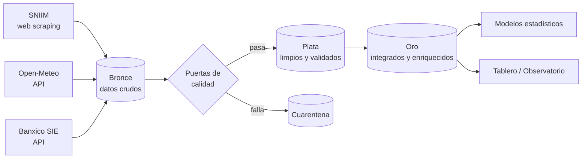

# LimónLab Colima — Observatorio del Limón

**Proyecto Integrador Colegiado "Trusted Data Lab" — Unidades 3 y 4**
Tecnológico Nacional de México, campus Colima

| Asignatura | Docente |
|---|---|
| Ingeniería de Datos | Armando Roman Gallardo Heredia |
| Análisis Estadístico para Ciencia de Datos | Mtro. Joel |
| Calidad en los Sistemas de Información | Mtra. Isis |

**Integrante:** Liza la foránea (trabajo individual)

## ¿Qué es LimónLab Colima?

Un laboratorio de inteligencia de datos que construye un **observatorio en línea del precio del limón mexicano (origen Colima)** en las principales centrales de abasto del país. El precio se integra con el **clima de la zona productora (Tecomán)** y el **tipo de cambio USD/MXN**.

### Pregunta de investigación

> ¿En qué medida la lluvia, la temperatura de la zona productora y el tipo de cambio explican las variaciones del precio de mayoreo del limón mexicano de Colima?

## Arquitectura (Medallón)



| Capa | Contenido | Carpeta |
|---|---|---|
| Bronce | Respuesta original de cada fuente, sin modificar, con fecha de captura | `data/bronze/` |
| Plata | Datos tipificados, normalizados, deduplicados y validados | `data/silver/` |
| Cuarentena | Registros rechazados por las puertas de calidad, con el motivo | `data/quarantine/` |
| Oro | Tabla analítica diaria: precio + clima + tipo de cambio + variables derivadas | `data/gold/` |

## Fuentes de datos

| Fuente | Método | Variables |
|---|---|---|
| SNIIM – Secretaría de Economía | Web scraping | Precio mín/máx/frecuente del limón por central, origen y presentación |
| Open-Meteo (Historical Weather API) | API REST, sin clave | Precipitación y temperatura diarias en Tecomán, Colima |
| Banxico SIE (serie SF43718) | API REST, token gratuito | Tipo de cambio FIX USD/MXN |

Detalle en [`docs/catalogo_fuentes.md`](docs/catalogo_fuentes.md).

**Atribución:** datos meteorológicos de [Open-Meteo.com](https://open-meteo.com/) (CC BY 4.0); precios del SNIIM, Secretaría de Economía; tipo de cambio de Banco de México (SIE).

## Estructura del repositorio

```
Proyecto_Limones/
├── config/            # parámetros del pipeline
├── data/
│   ├── bronze/        # crudo
│   ├── silver/        # limpio
│   ├── gold/          # analítico
│   └── quarantine/    # rechazados
├── src/
│   ├── ingest/        # scrapers y clientes de API
│   ├── quality/       # puertas de calidad
│   └── transform/     # bronce → plata → oro
├── notebooks/         # análisis estadístico
├── dashboard/         # observatorio en línea
├── docs/              # documentación
├── tests/             # pruebas automáticas
└── logs/              # bitácoras de ejecución
```

## Entregas

| Etiqueta | Entrega | Peso | Estado |
|---|---|---|---|
| `e0` | Propuesta, máquina de captura (Bronce) y sistema de calidad inicial — [`docs/E0/`](docs/E0/) | 10 % | Entregada (entrevista de campo pendiente) |
| `e1` | Limpieza estadística, puerta de calidad Pandera y capa Oro — [`docs/E1/`](docs/E1/) | 40 % | Entregada |
| `e2` | Experimento con factores | 20 % | Pendiente |
| `e3` | Comparación de grupos multivariados | 15 % | Pendiente |
| `e4` | Por definir según rúbrica | 15 % | Pendiente |

Detalle en [`docs/plan_entregas.md`](docs/plan_entregas.md).

## Cómo ejecutar

```powershell
python -m venv .venv
.venv\Scripts\Activate.ps1
pip install -r requirements.txt
copy .env.example .env   # y pega tu token de Banxico
python -m pytest         # 25 pruebas automáticas
python -m src.pipeline   # captura incremental + capa Plata
```